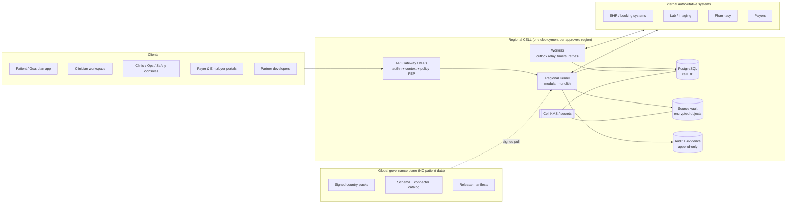
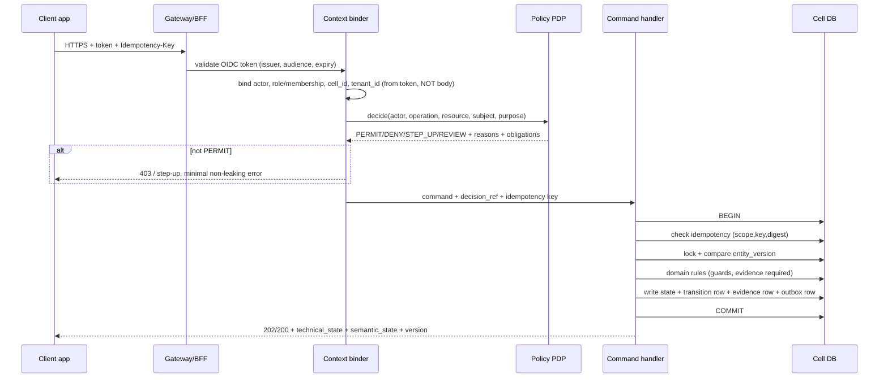

# Zoiko Access: Backend Architecture (build design, step 1)

Status: PROPOSED engineering design. Derived from R3.0 master, GHE-03/06/10/11/12/13, and the schema pack in `../../docs/schema/`. The docs leave framework, DB, workflow engine and IAM vendor OPEN (ADR-08). The "default" below is a starting choice for building and learning, each behind an interface so it can be swapped. Nothing here is a launch claim.

Each section ends with **Why (learn this)** so you understand the reason, not just the shape.

---
## 1. Decisions (defaults, all swappable)

| Concern | Default for now | Why this default | Swap-out trigger |
|---|---|---|---|
| Language/framework | Python 3.12 + Django 5 (+ Django Ninja or DRF for APIs) | GHE-03 names Django/Python as a candidate; you know Python; migrations, ORM, permissions, testing built in | Team picks another framework (one only, GHE-03 §11) |
| Database | PostgreSQL 16, one DB per cell | Transactions + outbox + RLS; GHE-03 prefers managed PostgreSQL-class | Market forbids managed PG |
| Workflow engine | **Our own small DB-backed state machine + worker**, behind a `WorkflowEngine` interface | Docs say do not adopt Kubernetes/Temporal prematurely; a Temporal-class engine is a candidate once timers/human waits grow | Long-running timers, replay, many journeys |
| Events | Transactional **outbox in Postgres** + relay worker (`FOR UPDATE SKIP LOCKED`) | No broker needed to be correct; at-least-once is built from the outbox | Throughput needs a broker (Redis Streams / NATS / Kafka) |
| Auth | OIDC (OAuth2) token validation; dev uses a local stub issuer | Real IAM is "buy"; our code only validates tokens + binds context | Pick qualified IAM vendor |
| Policy | In-process **Policy Decision Point** module, rules as versioned data | Every call needs allow/deny with reasons + audit; start simple, keep it testable | Move to external engine (OPA-class) |
| Object/source vault | Local filesystem (dev) behind a `Vault` interface; S3-class + KMS later | Raw payloads must be encrypted, immutable, referenced by digest | Cell hosting decision |
| Async jobs | Django management-command workers (outbox relay, timers, retries) | Simple, observable, no extra infra | Scale |
| Packaging | Docker Compose for local; one container image per deployable | Reproducible; Kubernetes only when evidence demands | Scale/ops |
| API style | REST + JSON, OpenAPI contracts first; webhooks signed | GHE-13 | n/a |

**Why (learn this):** the architecture is the *rules* (cells, evidence, policy, outbox). The tools are replaceable. We build the rules into code and keep tools behind interfaces.

---
## 2. System context (what talks to what)



**Why:** patient data never leaves the cell. The global plane only *publishes* signed configuration; the cell *pulls* and verifies it. Partners stay authoritative.

---
## 3. The regional kernel: modules (a modular monolith)

One deployable Django project (`backend/`), split into **bounded-context modules** that mirror the domains (D01..D05, D16, D17 first). Not 18 microservices (GHE-03 §06).

```
backend/
  config/            Django wiring: settings (base/dev/test), urls, wsgi/asgi
  foundation/        shared plumbing: ids, time, outbox, inbox, idempotency, errors, vault interface, db session context
                     (named `foundation`, NOT `platform`: a top-level `platform` package would shadow Python's stdlib module)
  modules/           the business modules, one folder each:
    trust/           D01  tenants, orgs, actors, persons, source links, roles, delegation        -> schema `trust`
    policy/          D02  purpose grants, flows, access decisions (PDP), transfers, rights        -> schema `policy`
    catalog/         D03  practitioners, services, locations, listings, verification              -> schema `catalog`
    scheduling/      D04  booking intents, availability, partner bookings, events                 -> schema `scheduling`
    workflow/        D05  definitions, instances, transitions, tasks, timers, exceptions          -> schema `workflow`
    comms/           D16  intents, messages, attempts, receipts, preferences                      -> schema `comms`
    evidence/        D17  audit events, disclosure log, evidence records, provenance              -> schema `evidence`
    (later) referral/ exchange/ finance/ integration/ safety/ analytics/ ai/
  tests/             tests that cut across modules (settings, health, ids...)
  requirements/      dependency lists
  docs/              this document + decisions
```

**Rules enforced by tooling (`import-linter`):**
1. A module may import another module's **public service interface** only (`module/api.py`), never its models.
2. Only the owning module writes its tables (one write owner per aggregate, GHE-11).
3. Cross-module reactions happen through **events** (outbox), not direct writes.
4. Country/market specifics are **data** (country pack), never `if country == ...` in code (R3.0 §01).

**Inside every module (consistent layering):**
```
module/
  models.py        tables (schema owned by this module)
  domain.py        pure rules + state machines (no DB, no HTTP) -> easiest to unit test
  services.py      use-cases / command handlers (the only place that opens a transaction)
  api.py           PUBLIC interface other modules may call
  http.py          request/response mapping (thin)
  events.py        event types this module publishes/consumes
  policy_rules/    what operations exist + their resource class + purpose
  tests/           unit + contract + denial tests
```

**Why (learn this):** keeping `domain.py` free of the database means you can test the most important logic (state transitions, invariants) with plain Python in milliseconds.

---
## 4. Request pipeline: what happens on every call



Pipeline guarantees:
- `cell_id` and `tenant_id` come from the **verified token and routing**, never the request body (GHE-11 CT-04). They are set as DB session variables for Row-Level Security as a second fence.
- Every call produces a `policy.access_decision` row and an `evidence.audit_event` row, **including denials** (without leaking whether the patient exists).
- Responses never contain PHI in error messages. Errors use stable codes (`POLICY_DENIED`, `CONFLICT_VERSION`, `DUPLICATE_COMMAND`, ...).
- UI hiding is never enforcement; the server denies independently.

**Why (learn this):** "login = permission" is the classic healthcare-app bug. Here, authentication only proves who you are; the PDP decides what you may do *right now, for this patient, for this purpose*.

---
## 5. The write path: the one transaction (most important pattern)

For every state change, in ONE database transaction:
1. check idempotency record (scope, key hash, request digest). Same key + different body = `CONFLICT`.
2. lock the aggregate row, compare `entity_version` (optimistic concurrency; mismatch = `CONFLICT_VERSION`).
3. run domain guards (`domain.py`): is this transition allowed, is required evidence present, is the actor the right owner?
4. update the aggregate (+1 version).
5. append `workflow_transition` / module event row (append-only, hash-chained).
6. append `evidence_record` pointer(s).
7. insert `outbox_event`.
8. commit.

An outbox **relay worker** then delivers events at-least-once; consumers use an **inbox** keyed by `event_id` so duplicates cause no second effect.

External calls (partner booking, email, payment) are **never** made inside this transaction. Instead the handler records a `pending_external_operation` + outbox row; a worker performs the call, and the result comes back as an event. Uncertain outcomes become `UNKNOWN` / `PENDING_RECONCILIATION`, never guessed success (GHE-11/12).

**Why (learn this):** if the app crashes after writing state but before sending the event (or the reverse), you get silent data loss or duplicates. The outbox makes "state changed" and "event queued" a single atomic fact.

---
## 6. Workflow engine (spine of every journey)

```
workflow/
  engine.py        interface WorkflowEngine: start(), submit_transition(), fire_timer(), signal()
  db_engine.py     default implementation backed by workflow.* tables
  definitions/     versioned JSON/YAML (J1.booking.v1 ...) -> loaded + hashed + signed
  guards.py        reusable guards: actor_is_owner, evidence_present, pack_allows, policy_current
  worker.py        timer + retry loop
```

- A **definition** lists states, allowed transitions, guards, required evidence, timers, exceptions, and the closure predicate. It is immutable once released; running instances **pin** their version.
- Transition guards check (every time): current country pack, purpose, initiator authority, data residency, step owner, source-system acknowledgment.
- Technical receipts (HTTP 2xx, HL7 ACK, email "delivered") are **inputs** that can never satisfy `CLINICAL_REVIEWED` or `HANDOFF_ACKNOWLEDGED`.
- Timers: stored with UTC deadline + zone + business calendar; a timer firing after completion is a no-op; a timer is a prompt to escalate, never proof of anything.
- Interface exists so a Temporal-class engine can replace `db_engine.py` later without touching modules.

**Why (learn this):** healthcare journeys are long, involve many parties and failures. Modeling them as explicit state machines with evidence is what stops "message sent" being mistaken for "care happened".

---
## 7. Policy decision point (PDP)

Inputs: actor, role/membership, organization, subject, relationship (care link or delegation grant), operation, resource class (D0..D6), purpose, flow revision, country pack, current consent/authority, cell.
Output: `decision` + `reason_codes[]` + `obligations[]` + `scoped_fields` + `expires_at`.

Evaluation order (fail closed, first deny wins):
1. cell/tenant binding valid? 2. country pack active and feature allowed? 3. flow revision approved for this purpose? 4. authentication strength sufficient (else `STEP_UP`)? 5. role/membership valid? 6. patient identity linked (not `POSSIBLE_MATCH`/`CONFLICT`)? 7. care relationship or valid delegation? 8. consent/authority current? 9. source-system rights? 10. field/record filtering and obligations.

Policy rules are data: `{operation, resource_class, allowed_roles, required_checks, purpose_codes}` with a version + hash. Each decision stores the policy version so it can be replayed later.

Special: break-glass DISABLED unless the pack enables it; employer/payer roles can never obtain D3 clinical classes.

**Why (learn this):** auditors and clinicians will ask "why was this allowed?". Storing the decision, the inputs and the policy version answers it months later.

---
## 8. Cells, tenancy and config

- A **cell** = one deployment (own DB, KMS keys, object store, audit store, workers) for an approved jurisdiction. Dev uses one cell `DEV-01`.
- `CELL_ID` and the pack are **deployment config**; the same code runs in every cell.
- The kernel pulls the signed pack from the global plane (or a local file in dev), **verifies signature, expiry, revocation epoch and version**, and refuses to enable capabilities that are missing/expired (fail closed).
- Tenancy inside a cell: `tenant_id` on every row + RLS policies `USING (tenant_id = current_setting('app.tenant_id') AND cell_id = current_setting('app.cell_id'))`. RLS is a safety net; field/record policy in the PDP is still required (row isolation alone is not enough for multi-role clinical records, GHE-10).
- No cross-cell calls except through signed single-use **transfer permits** (not built until needed; default deny).

---
## 9. Interfaces for the outside world

**Contracts first** (`contracts/` folder): OpenAPI for REST, AsyncAPI/JSON Schema for events, compatibility fixtures. Code is generated/validated against them.

| Surface | Style | Rules |
|---|---|---|
| Role apps → BFF | REST/JSON | One BFF per audience (patient, clinician, org, ops...); minimal fields only |
| Partner/connector | REST + signed webhooks; FHIR R4 / HL7 v2 adapters later | Idempotency-Key header (16-128 chars), `202` = accepted by us only, signed payloads, replay protection |
| Events | Typed versioned envelope `{event_id, type, schema_version, occurred_at, recorded_at, cell_id, subject_ref, correlation_id, causation_id, policy_ref, evidence_ref, ack_class}` | At-least-once, dedupe by `event_id`, no PHI in payload (refs only) |
| Errors | RFC 9457 problem+json with stable `code`, `request_id`, `retryable` | Never PHI |
| Public identifiers | opaque `public_id` | Never national id/MRN/timestamp |

---
## 10. Security and privacy built in (not bolted on)

- TLS 1.2+ (1.3 preferred); mTLS for partner links later; secrets only from a vault/env, never in code or logs.
- PHI never in URLs, logs, metrics, traces, error text, analytics tools, or AI prompts. A logging filter + tests enforce this.
- Cell-owned encryption keys (KMS); encrypted columns for D2/D3 identifiers; source payloads encrypted in the vault with digest + immutable revision.
- Support/admin access only via JIT, expiring, dual-approved grants; no standing cross-tenant clinical access.
- Rate limits, anti-enumeration, adaptive throttling on auth/search.
- Supply chain: pinned dependencies, SBOM, signed artifacts in CI.
- Observability: structured logs with correlation ids; metrics/traces carry **no PHI** (global telemetry allowlist).

---
## 11. Repository layout (matches GHE-01 §12)

```
zoikoaccess/
  backend/             ALL server code (section 3). Python/Django.
  frontend/            ALL web/mobile clients (Next.js, one app per audience, later)
  docs/                design documents (schema pack, ...)
  docker-compose.yml   local stack for one cell
  .env.example         dev placeholders (real .env is never committed)
  .github/workflows/   CI
```

Folders the docs call for (GHE-01 §12) are added **inside `backend/` only when the step that needs them arrives**, so nothing sits empty:

| Future folder | Holds | Arrives with |
|---|---|---|
| `backend/contracts/` | OpenAPI, AsyncAPI, JSON Schema, compatibility fixtures | first public API |
| `backend/policy_packs/` | signed country packs, admit/deny fixtures | B5 policy |
| `backend/workflows/` | versioned definitions (J1.booking.v1...), evidence validators | B6 workflow |
| `backend/connectors/` | partner adapters, simulators, mapping files, certification results | B8 |
| `backend/quality/` | requirements traceability, go-live evidence | hardening phase |
| `backend/scripts/` | operational helpers | when needed |
| `infra/` (top level) | infrastructure-as-code, runbooks, SLO alerts | deployment phase |

---
## 12. Testing strategy (this is where safety lives)

1. **Unit** (`domain.py`): state machines, invariants, guards.
2. **Contract**: API + events validate against `contracts/`; consumer compatibility fixtures.
3. **Denial tests (mandatory per role):** employer cannot read clinical data; patient A cannot read patient B; clinician without care relationship is denied; expired grant denied; unknown state never maps to success.
4. **Idempotency/concurrency:** same key twice; two writers racing on `entity_version`; outbox duplicate delivery.
5. **Failure injection:** partner timeout → `UNKNOWN`; crash between commit and relay; stale timer firing after completion.
6. **Evidence integrity:** hash chain verification detects gaps/tampering.
7. **No-PHI-in-logs** scanning test.
Each requirement/hazard links to tests in `quality/` (traceability).

---
## 13. Backend build steps (one feature per step, backend then frontend)

| Step | Build | You learn |
|---|---|---|
| B0 | Repo skeleton, Docker Compose (Postgres), settings, lint + import rules, CI stub | Project structure, environments |
| B1 | `platform`: ids (UUIDv7 + public_id + ref_no), time utilities, error model, db session context (cell/tenant) | IDs, UTC/zone handling |
| B2 | `platform`: outbox, inbox, idempotency (+ tests) | Reliable messaging |
| B3 | `evidence`: audit_event + disclosure log with hash chain | Tamper-evident logs |
| B4 | `trust`: tenant, org, actor, person, role, membership (+ dev OIDC stub) | AuthN vs identity vs authZ |
| B5 | `policy`: access_decision + minimal PDP + denial tests | Policy-based access |
| B6 | `workflow`: definition loader, instance, transition, guards (J1 booking.v1) | State machines + evidence |
| B7 | `catalog` + `scheduling`: service/location, booking intent → partner booking | Authoritative source rule |
| B8 | Partner simulator + worker (pending op, UNKNOWN, reconciliation) | Uncertain outcomes |
| B9 | `comms`: intent + attempt + receipt (receipt ≠ review) | Evidence kinds |
| B10 | Role BFFs + first UI slice (patient request, clinic confirm, ops exception view) | Server-side enforcement |
Each step ends with its tests green and a short review before the next.

---
## 14. Open decisions for the team (do not guess)

1. First market/journey/buyer (ADR-07). Defaulting to J1 only for the learning build.
2. Framework, DB, workflow engine, IAM vendor, cloud (ADR-08). Defaults above are build-time only.
3. Retention periods and key rotation per data class and market (ADR-10).
4. One severity scale (README §6.2 in `../../docs/schema`).
5. ADR-06: Zoiko's legal operating role per service (infrastructure supplier vs marketplace vs provider). Affects which data flows are allowed at all.
