# 01. ER diagrams (relationships)

Mermaid syntax (renders in VS Code with a Mermaid preview extension, or GitHub). Only keys and the important columns are shown. Full columns are in files 02-05.
Legend: `||--o{` one-to-many, `}o--o{` many-to-many (via junction table), `||--||` one-to-one. FKs inside a cell never cross to another cell. Cross-cell links are by signed permit only, never by FK.

## D1. Planes and cells (global vs cell)

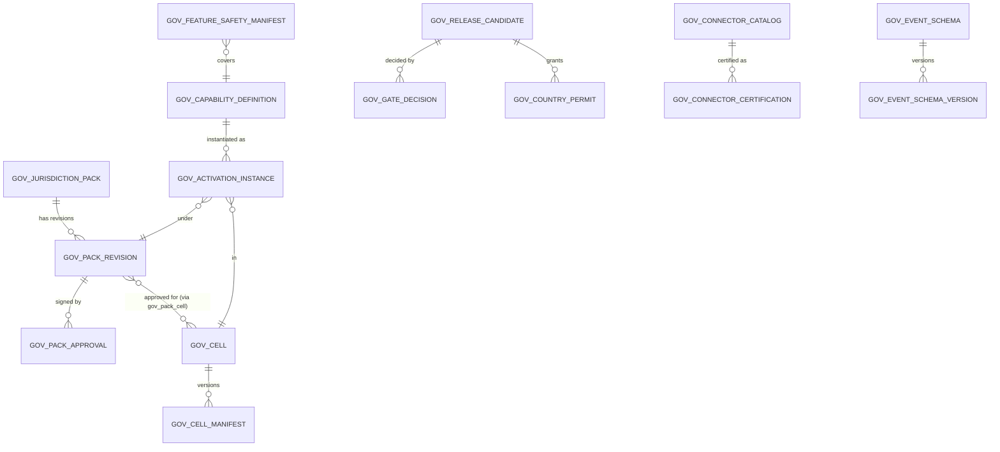

## D2. Identity, tenancy, delegation (cell)

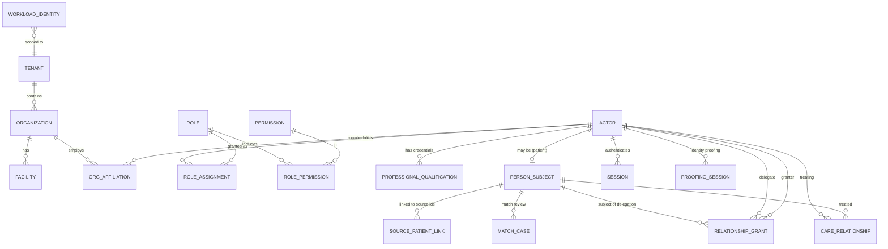

## D3. Policy, purpose, privacy

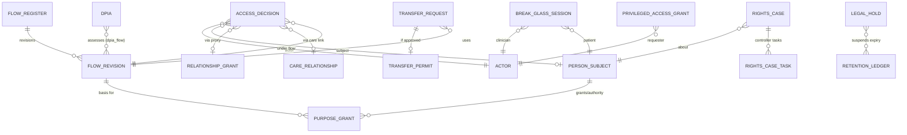

## D4. Catalog, scheduling, referral (core of J1/J2)

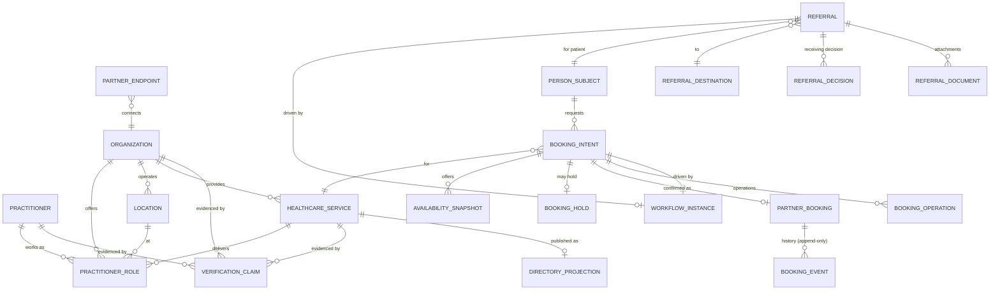

## D5. Workflow fabric (the spine)

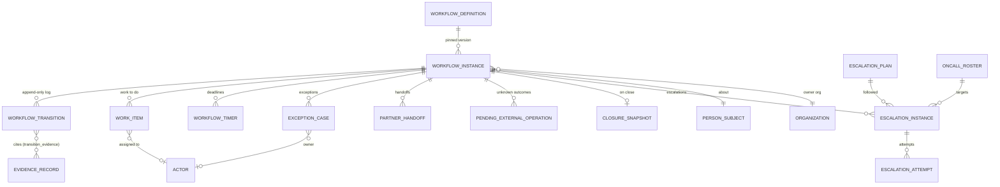

## D6. Clinical exchange, provenance, evidence

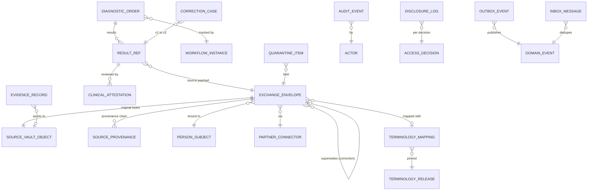

## D7. Payer, entitlements, billing, ledger

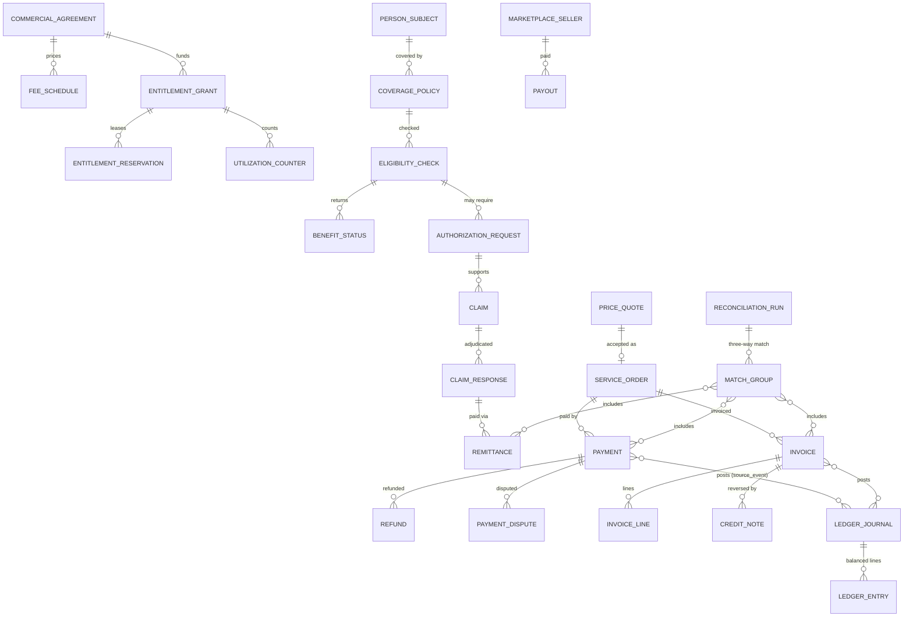

## D8. Communications and escalation

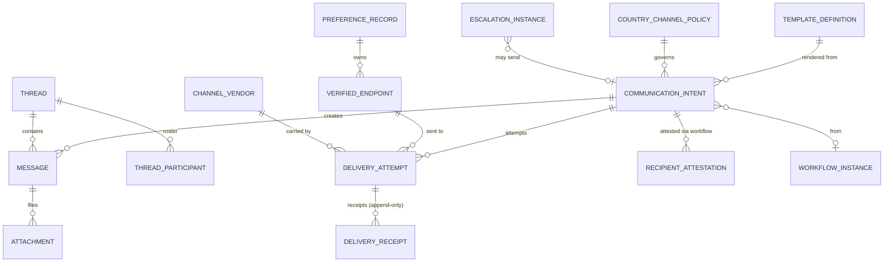

## D9. Partner APIs, connectors, certification

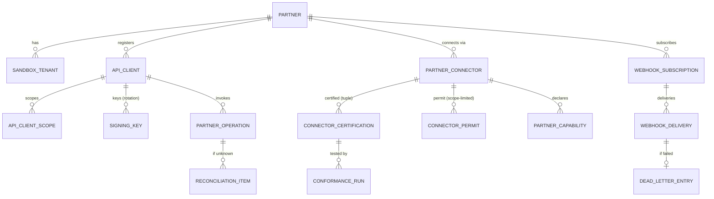

## D10. Safety, security, release, quality (governance spine)

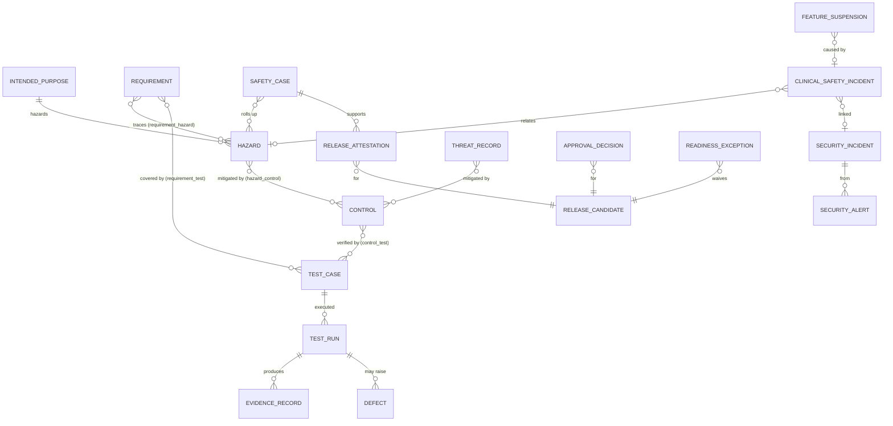

## D11. Master reference chain: "one request end to end" (J1)

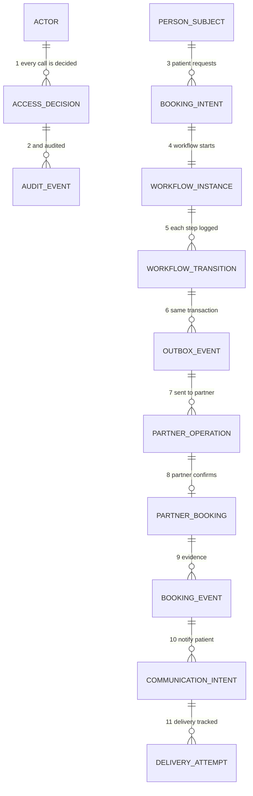
